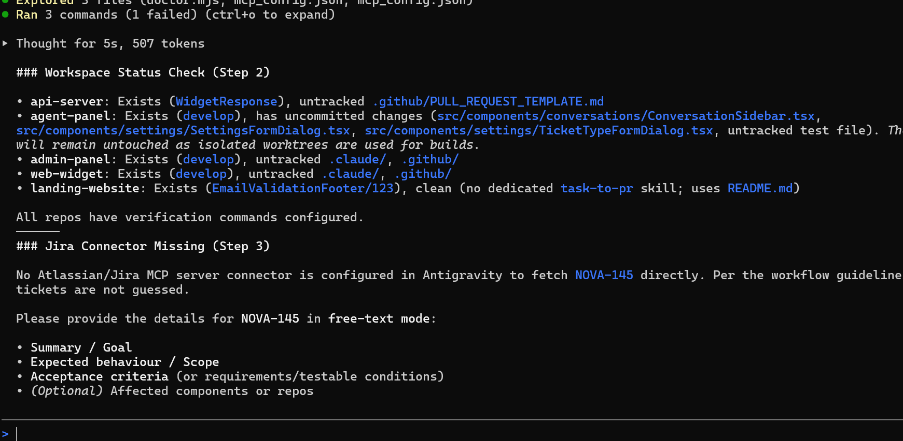

# Dev-Agent setup guide

Follow these steps in order. At the end you will have Dev-Agent running, connected to Jira, solving a ticket, and
showing every change in your own editor.

Dev-Agent never pushes code or opens pull requests. It builds on local git branches and you review them.

## 1. Project setup

**1. Install the tools (once).** Check each one:

```bash
git --version
node --version
```

You also need one AI tool: **Claude Code** or **Antigravity** (IDE and/or `agy` CLI).

```bash
npm install -g @anthropic-ai/claude-code
claude --version
```

Antigravity: download the IDE from https://antigravity.google. For the CLI, run one of these:

```powershell
irm https://antigravity.google/cli/install.ps1 | iex
```

```bash
curl -fsSL https://antigravity.google/cli/install.sh | bash
```

After installing the CLI, **open a new terminal**, then run `agy --version`. (An already open terminal does not
see the new PATH.)

**2. Clone Dev-Agent** to a folder you will keep (the setup points back at it):

```bash
git clone https://github.com/MahimaSoni33/Dev-Agent.git C:/dev-agent
```

**3. Open it in your IDE.**

- VS Code: `code C:/dev-agent`, or File > Open Folder.
- Antigravity IDE: File > Open Folder > `C:/dev-agent`.

Open the terminal inside the editor with `` Ctrl+` ``.

**4. Install dependencies.** Dev-Agent has no npm packages, so there is nothing to install for it. Install the
dependencies of **your own project** instead, because Dev-Agent links them into its worktrees:

```bash
cd <your-project-repo>
npm install
```

Use your stack's install command if it is not Node.

**5. Environment variables and keys.**

| What | What to do |
|---|---|
| Dev-Agent itself | Needs **no** API key and no environment variable |
| Claude Code | Run `claude` once and sign in when asked |
| Antigravity | IDE: sign in at first launch. CLI: run `agy` once and sign in |
| Jira | Signs in through your browser (section 3). No token goes in a file |
| Your project's `.env` | Create it as usual. The agent is blocked from reading it |

**6. Run and verify:**

```bash
cd C:/dev-agent
npm test
```

All tests should pass. Then check your machine:

```bash
node scripts/doctor.mjs --cwd "<your-project-folder>"
```

`[ ok ]` means ready. `[FAIL]` lines say what to fix. `[warn]` and `[info]` lines are optional.

## 2. Local IDE integration

### Claude Code (in VS Code or Antigravity)

1. Open **your project folder** in the IDE (File > Open Folder). Use the folder that holds your repo, or the
   folder that contains your repos side by side.
2. Open the editor terminal and start Claude with Dev-Agent loaded:

```bash
claude --plugin-dir C:/dev-agent
```

3. Run the agent in the chat that opens:

```
/dev-agent:solve-ticket NOVA-145
```

### Antigravity IDE

1. From the **project folder**, run the guided setup. It checks your machine and installs Dev-Agent into
   Antigravity:

```bash
node C:/dev-agent/scripts/setup.mjs
```

2. Open that folder in Antigravity (File > Open Folder).
3. In the agent chat type:

```
Use the solve-ticket skill for NOVA-145
```

### Antigravity CLI

```bash
cd <your-project-folder>
agy
```

Then, at the `agy` prompt (not in PowerShell):

```
/solve-ticket NOVA-145
```

### Where to see what the agent changed

The agent builds in a separate copy of your repo (a git worktree), so your own files stay untouched until you
decide. It lives here:

```
C:\Users\<you>\.dev-agent\runs\<project>\<TICKET>\worktrees\<repo>
```

The same folder holds `plan.md` and `summary.md` (branch names, results and PR text).

1. **Open it in the editor.** File > Open Folder, and paste the worktree path. Or from a terminal:

```bash
code "$HOME/.dev-agent/runs/<project>/<TICKET>/worktrees/<repo>"
```

(In Antigravity, use File > Open Folder. I have not confirmed a command-line launcher for it.)

2. **Explorer** (`Ctrl+Shift+E`): changed and new files show a colored letter or dot (M modified, U new).
3. **Source Control** (`Ctrl+Shift+G`): lists every changed file. Click a file to see a side-by-side diff of old
   against new. This is the best place to review.
4. **Terminal** (`` Ctrl+` ``), inside the worktree:

```bash
git branch --show-current
git status
git diff --stat
git diff
git log --oneline -5
```

5. **Compare with the base branch** (use your repo's base, for example `develop`):

```bash
git diff origin/develop...HEAD
```

## 3. Jira MCP integration

This lets `solve-ticket NOVA-145` read the ticket by itself. **Without it, the agent stops and asks you to type
the ticket details.** That is not a bug:



You need an Atlassian cloud site with Jira, and an account that can see the ticket. Atlassian's server address
is `https://mcp.atlassian.com/v2/mcp` (from Atlassian's documentation). Sign-in uses OAuth in your browser, so
you never paste a password or token. An API token is only needed if your admin turned that option on.

### A. Claude Code (terminal, VS Code, or the Code tab in the Claude desktop app)

1. Add the server. Run this in a normal terminal:

```bash
claude mcp add --transport http atlassian https://mcp.atlassian.com/v2/mcp
```

   The default scope is only you, in the current project. To use it in every project add `--scope user`.

2. Start Claude, then type `/mcp`, choose **atlassian**, and follow the steps in your browser to sign in.
3. **Restart Claude** (type `/exit`, then start it again).
4. Verify:

```bash
claude mcp list
```

   It should show `atlassian` with `✔ Connected`. `! Needs authentication` means finish step 2.

Claude Desktop chat: you can also install Atlassian from Settings > Extensions > Browse extensions > Plugins, or
add it at https://claude.ai/customize/connectors. Servers added there appear in Claude Code when you are signed
in with the same claude.ai account. Dev-Agent itself runs in Claude Code.

### B. Antigravity IDE

1. In the agent side panel click **...** at the top, then **MCP Servers**.
2. Click **Manage MCP Servers**, then **View raw config**. This opens `mcp_config.json`.
3. Add the Atlassian server (keep any servers already there):

```json
{
  "mcpServers": {
    "atlassian": {
      "serverUrl": "https://mcp.atlassian.com/v2/mcp"
    }
  }
}
```

4. Save, then **restart Antigravity**. Sign in through the browser window when the first Jira request asks.

### C. Antigravity CLI

1. Add the same JSON to `~/.gemini/config/mcp_config.json`
   (Windows: `C:\Users\<you>\.gemini\config\mcp_config.json`). This applies to all projects. For one project
   only, use `<project>/.agents/mcp_config.json`.
2. Run `agy`, type `/mcp`, and press Enter. Check that `atlassian` is listed with a healthy status (the screen
   shows live status and connection logs).
3. If it needs sign-in, finish it in the browser. Restart `agy` after editing the file.

### Verify, either way

```bash
node C:/dev-agent/scripts/doctor.mjs --cwd "<your-project-folder>"
```

It should print `[ ok ] Jira connection found in MCP config: "atlassian"`. This check only reads the server
name from the Antigravity config. For Claude, use `claude mcp list` above.

If the connection fails: Atlassian has changed its address before (`/v1/mcp` was the earlier one), so check
Atlassian's "Atlassian Rovo MCP server" documentation for the current URL. Your Atlassian admin may also need to
allow MCP connections. The Antigravity docs say remote servers must use Streamable HTTP, and the config key is
`serverUrl`.

## 4. Complete execution workflow

Clone > Install > Configure > Open IDE > Connect Jira > Run agent > Execute Jira task > Review > Test.

| Step | What you do |
|---|---|
| 1. Clone | `git clone https://github.com/MahimaSoni33/Dev-Agent.git C:/dev-agent` |
| 2. Install | Install Git, Node, and Claude Code or Antigravity. Run `npm install` in your project |
| 3. Configure | Sign in to Claude or Antigravity. Run `node C:/dev-agent/scripts/doctor.mjs --cwd "<project>"` |
| 4. Open IDE | Open your project folder in VS Code or Antigravity |
| 5. Connect Jira | Section 3. Restart the client. Verify with `claude mcp list` or `/mcp` |
| 6. Run agent | Claude: `claude --plugin-dir C:/dev-agent`. Antigravity: `node C:/dev-agent/scripts/setup.mjs` once, then `agy` |
| 7. Execute the task | `/dev-agent:solve-ticket NOVA-145` (Claude), `/solve-ticket NOVA-145` (agy), or `Use the solve-ticket skill for NOVA-145` (IDE chat) |
| 8. Review | Open the worktree in the editor. Use Explorer, Source Control, and `git diff` (section 2) |
| 9. Test | See below |

**Step 7 in detail.** The agent reads the ticket and writes `plan.md`. It then asks you to approve the plan
(**Gate 1**), builds each repo on a new branch and reviews it, and asks which repos get a local commit
(**Gate 2**). Choose no commit if you want to test first: the edits stay uncommitted in the worktree.

**Step 9: test the branch before you commit.**

```bash
cd ~/.dev-agent/runs/<project>/<TICKET>/worktrees/<repo>
cp "<path-to-your-repo>/.env" .env
npm run dev
```

1. Copy your `.env` in yourself. The agent cannot read it, and you must never commit it.
2. Stop your own copy of the same app first, or the ports clash.
3. Run the repo's checks, for example `npm test` or `npm run lint`, and try the behavior against the ticket's
   acceptance criteria.
4. If it works, commit from the worktree. Name the files, because `git add .` is blocked:

```bash
git add <file1> <file2>
git commit -m "NOVA-145: <summary>"
```

5. Push and open the pull request yourself, using the text in `summary.md`:

```bash
git push -u origin <branch>
```

## Troubleshooting

| Problem | Fix |
|---|---|
| `/solve-ticket` is "not recognized" in PowerShell | It is a chat command, not a shell command. Start `agy` or Claude first, then type it |
| `agy` is "not recognized" right after installing | Open a **new** terminal |
| The agent asks you to type the ticket | Jira is not connected. Do section 3 |
| `Repository not found` on fetch | Git has the wrong GitHub login. Sign in again or fix the saved Windows credential |
| Agent cannot edit the worktree (Antigravity) | Add the folder `~/.dev-agent/runs`: `agy --add-dir ~/.dev-agent/runs` |
| `[FAIL]` from doctor | Read the `fix:` line under it, then run it again |
